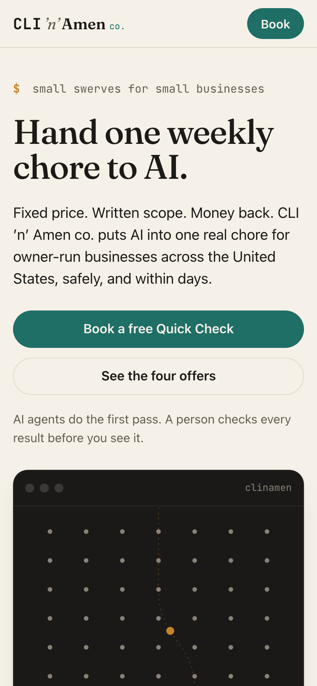

# CLI ’n’ Amen co.

The website of Clinamen, an AI consulting firm for owner-run small businesses, marketed as **CLI ’n’ Amen co.** One static page, no build step.

- Address: https://clinamenco.com (once the DNS below points here)
- Preview: https://evanmcdowell31.github.io/clinamen-site/
- The page lives in `docs/`; GitHub Pages serves it from `docs/` on `main`.

| Phone | Desktop |
| --- | --- |
|  |  |

More in `review/`: the offers on a phone, the name section, dark mode, and both full pages.

## What’s on the page

- **The swerve.** A terminal window in which atoms fall in straight lines until one swerves and knocks the others loose: Lucretius’ *clinamen*, and the CLI half of the name. It stops under “reduce motion”.
- **Chores we take off your plate:** the six typical fixes.
- **Four ways to work with us:** Quick Check (free), One Fix, Sprint and Care, with the founding prices, the money-back term and the founding-price limit, as the firm’s 90-day marketing plan proposes them.
- **How we work:** three steps, and the line that AI agents built on the open source [Irie](https://github.com/irie-people/irie) and Anthropic’s Claude do the first pass while a person checks every result.
- **Who we work with**, and what the firm doesn’t take yet.
- **The name:** a dictionary entry for *clinamen*, and how to say it.
- **How we handle your data:** the practices that are settled; see the checklist for the three to confirm.
- **Book a free Quick Check**, to the Calendly page, and the firm’s email.

The look: Fraunces for headings and the definition, JetBrains Mono for the CLI half of the wordmark, prices and labels, the system sans for text. Teal for actions, amber for the swerving atom. Light and dark follow the visitor’s setting. Both fonts are served from `docs/fonts/` under the SIL Open Font License, with the license files alongside, so the page loads nothing from other servers.

## Editing it

- **Prices and terms:** the `offers` section of `docs/index.html`, one `.price` block per offer, plus the two notes (money back, founding prices) and the JSON-LD block in `<head>`.
- **Email and booking link:** search `docs/index.html` for `protonmail` and `calendly`.
- **Screenshots, the share card (`docs/og.png`) and the app icon:** `node tools/shoot.mjs` (Node 22 or newer). It drives Playwright’s cached headless Chromium shell over the DevTools protocol; nothing is installed and no window opens. `?still` on the page stops the animation, `?og` draws the share card, `?icon` the icon.

## Go-live checklist

1. **DNS at Porkbun.** Delete the parking records (the ALIAS on `@` and the CNAME on `www`) and add:

   | Type | Host | Answer |
   | --- | --- | --- |
   | A | @ | 185.199.108.153 |
   | A | @ | 185.199.109.153 |
   | A | @ | 185.199.110.153 |
   | A | @ | 185.199.111.153 |
   | AAAA | @ | 2606:50c0:8000::153 |
   | AAAA | @ | 2606:50c0:8001::153 |
   | AAAA | @ | 2606:50c0:8002::153 |
   | AAAA | @ | 2606:50c0:8003::153 |
   | CNAME | www | evanmcdowell31.github.io |

2. **The custom domain on GitHub Pages.** Add `docs/CNAME` holding `clinamenco.com`, set the domain in the repository’s Pages settings, wait for the certificate, then turn on “Enforce HTTPS”. `www.clinamenco.com` then redirects to the apex.
3. **Prices.** The page shows the plan’s proposed prices and the founding-price limit (31 January 2027 or the first 10 paying clients). Confirm them before marketing starts, or change them as above.
4. **Data page.** Three practices are not yet specific on purpose: where job files are stored, what the AI provider keeps, and how many days after handover copies are deleted. Add them once settled.
5. **A postal address** is needed for marketing email (CAN-SPAM), not for the page.
6. **Email at the domain**, such as hello@clinamenco.com, if wanted: Proton Mail’s custom-domain feature, or Porkbun’s free email forwarding.
7. **A Google Business Profile**, if the founders meet clients in person.

## Sources

- Lucretius, *De rerum natura* II.216–293, the swerve of atoms, in the Perseus Digital Library: https://www.perseus.tufts.edu/hopper/text?doc=Perseus:text:1999.02.0130
- Wikipedia, “Clinamen”: the pronunciation /klaɪˈneɪmən/, the derivation from *clinare* and the plural *clinamina*: https://en.wikipedia.org/wiki/Clinamen
- GitHub Docs, “Managing a custom domain for your GitHub Pages site”: the A, AAAA and CNAME records above: https://docs.github.com/en/pages/configuring-a-custom-domain-for-your-github-pages-site/managing-a-custom-domain-for-your-github-pages-site
- Fraunces, by Undercase Type, and JetBrains Mono, by JetBrains, both under the SIL Open Font License 1.1 (`docs/fonts/*/OFL.txt`), fetched from Google Fonts.
- The offers, prices and wording follow the firm’s 90-day marketing plan (private).
